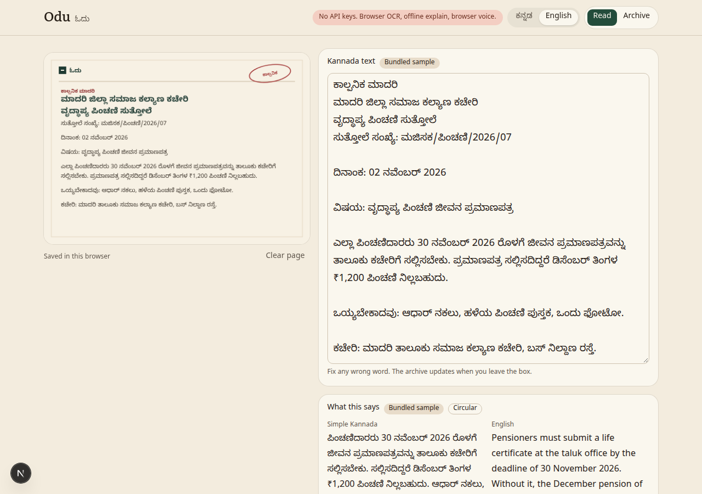
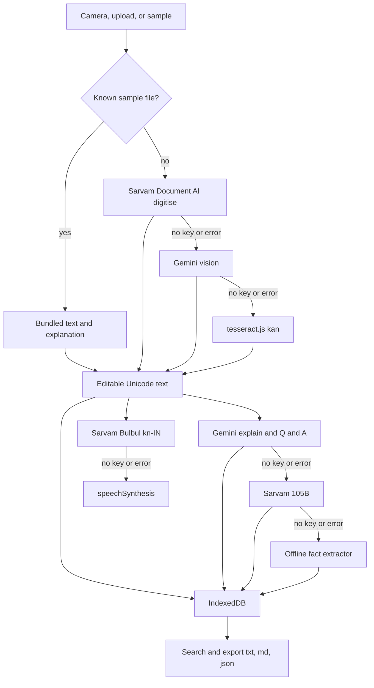

# Odu (ಓದು)

A phone friendly reader for Kannada paper. You photograph a notice, a land extract, or a letter. Odu turns it into Unicode text you can correct, explains it in simple Kannada and in English, reads it aloud, answers a question, and keeps it searchable in this browser.

Built for the Kannada Digital Innovation Hackathon 2026 (NIE Mysuru, on Unstop), problem statement 5, Kannada Text Digitization.



## The problem

People in Karnataka still get the important stuff on paper or as a photo: circulars, RTC or pahani extracts, pension and ration letters, school and hospital notices, old print, handwritten notes. Two groups get stuck. Readers who know Kannada but not officialese, and readers who do not know Kannada at all. A photo in a gallery is also a dead end the week you need the date again.

## What it does

1. Capture a photo, a scan, or the first page of a PDF. Mobile first.
2. Digitise to editable Unicode Kannada, shown next to the image.
3. Explain: a short simple Kannada summary, an English summary, fact chips (dates, deadlines, amounts, offices, reference numbers, names, the action), and a document type.
4. Listen to the Kannada summary or the full text.
5. Ask a question in Kannada or English. The answer follows the language you asked in.
6. Save every page in IndexedDB. Search in Kannada or English. Export `.txt`, `.md`, or JSON of the text (not the photo).

No accounts, no server database, no payments.

## Architecture



## Provider fallbacks

| Job | First | Then | Always available |
| --- | --- | --- | --- |
| OCR | Sarvam Document AI, `POST /doc-ai/v1/job/digitise`, language `kn-IN`, output `md`, then poll status and download the zip | Gemini vision `generateContent` | tesseract.js with the Kannada traineddata, in the browser |
| Explain and Q&A | Gemini | Sarvam chat `sarvam-105b` on `POST /v1/chat/completions` | Offline extractor: dates, rupee amounts, offices, reference numbers, and a first lines summary. Labelled Offline mode |
| Speech | Sarvam Bulbul `bulbul:v4-flash`, speaker `suchitra_kn_narration`, `kn-IN`. If that call fails, one retry with `bulbul:v3` and speaker `shubh` |  | `speechSynthesis` with `kn-IN` |

Keys are read only on the server: `SARVAM_API_KEY`, `GEMINI_API_KEY`, optional `GEMINI_MODEL` (default `gemini-3.8-flash`, the Flash id from the current Gemini image understanding docs). Nothing is sent to the browser. The header pill shows which path is configured. The page itself shows which path actually ran.

These provider calls are written against the public docs as of October 2026. This environment had no keys, so Sarvam and Gemini were not exercised live. If a key is present and the call fails, the next row in the table runs.

## Samples

`public/samples/` has five fictional pages rendered for this repo: a panchayat water notice, a pension circular, a land record extract, a clinic letter, and a book page. No real personal data, no government logos. Each one has precomputed text and an explanation in `data/samples.json`. Try a sample uses that JSON immediately. If you upload the same PNG, the file hash matches and you get the same prepared text.

Regenerate the PNGs with `npm run samples` (needs network once, to fetch Noto Sans Kannada).

## Setup

```bash
npm i
cp .env.example .env.local
npm run dev
```

`npm i` copies the Tesseract worker, Kannada traineddata, and the PDF.js worker into `public/vendor`. Those files are not committed. Dev server: [http://127.0.0.1:43123](http://127.0.0.1:43123).

Leave `.env.local` empty. The app is meant to run that way.

```bash
npm test
npm run build
```

`npm run build` does not need env vars.

## Deploy on Vercel

1. Push the repo to GitHub.
2. In Vercel, import the repo. Framework preset is Next.js. No extra config file is required.
3. Deploy with no environment variables. Samples, browser OCR, offline explain, and browser speech all work.
4. Optional, in Project Settings, Environment Variables: `SARVAM_API_KEY`, `GEMINI_API_KEY`, and `GEMINI_MODEL` if you want a different Flash id. Redeploy after saving them.
5. Sarvam digitise is an async job. The OCR route polls for about 20 seconds (`maxDuration` 60). On a short function limit the platform may cut the call off. The client then uses the next OCR path, ending at Tesseract.

## Search

Queries and stored text are NFC normalized. ZWJ, ZWNJ, and other invisible marks are removed, so a Kannada word still matches if one side was typed with a joiner. Kannada digits fold to ASCII digits. An English or transliterated query matches when those words are in the English summary or the other stored fields. An empty query lists everything.

## Limits

- One PDF page, the first.
- The archive lives in this browser only. Clearing site data clears it.
- Tesseract on a phone photo of real print is uneven, and handwriting is weaker still. The text box is there so a person can fix a line.
- Offline summaries are the first sentences plus regex facts, not a rewrite. Samples use hand written explanations so the demo is readable.
- Browser speech depends on the device. A Kannada voice is common on Android and often missing on a desktop, which then speaks with a default voice.
- Sarvam and Gemini were not called live in this build.

## Roadmap

Offline PWA. Handwriting fine tuning. Bulk ZIP import. A district office kiosk with large type and the archive kept on the machine.
